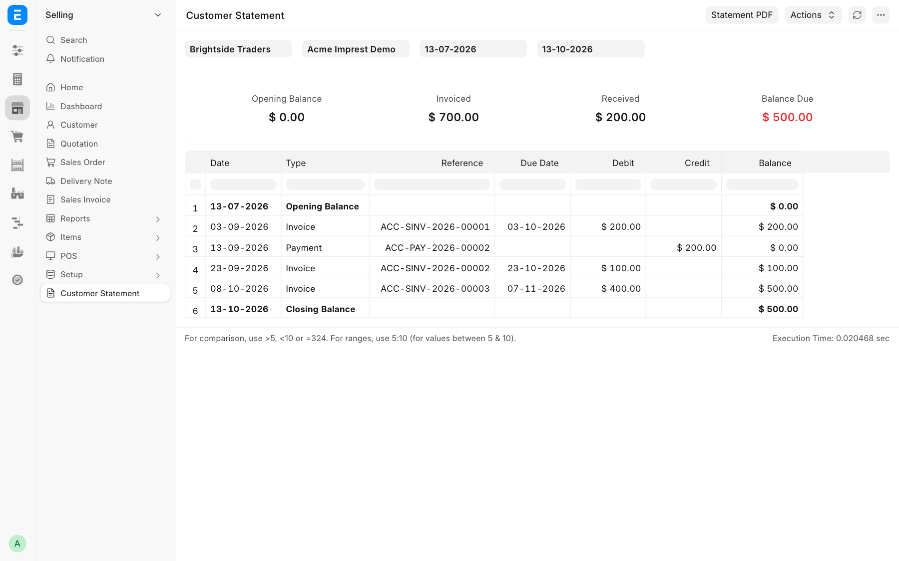
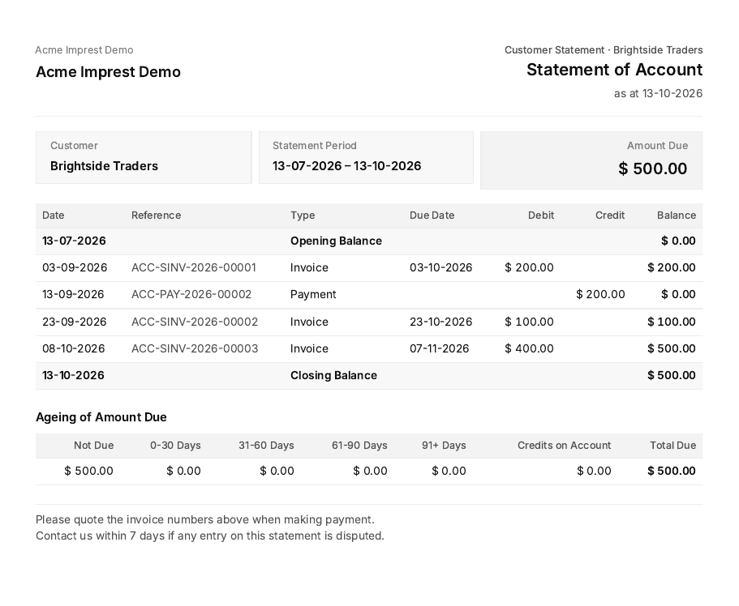

# Customer Statement

Open the **Customer Statement** report from the Selling sidebar, or **View → Customer Statement** on a Customer. Pick the customer, company and period.

- Opening balance, then invoices, payments and returns with a running balance.
- **Statement PDF** renders the `Customer Statement` print format with the issuer's logo, address, tax ID and contacts from the Company, and the first company Bank Account as payment details.
- The PDF ends with an ageing table by due date as at the end of the period: **Not Due**, 0-30, 31-60, 61-90, 91+ days past due, and credits on account. The buckets add up to the closing balance.

Period and company are passed to the print format as `from_date`, `to_date` and `company`.
